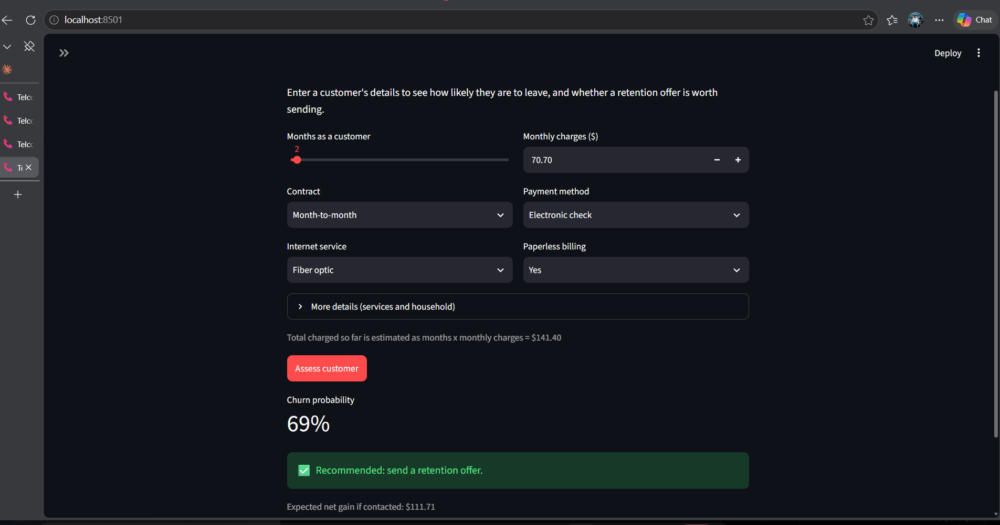
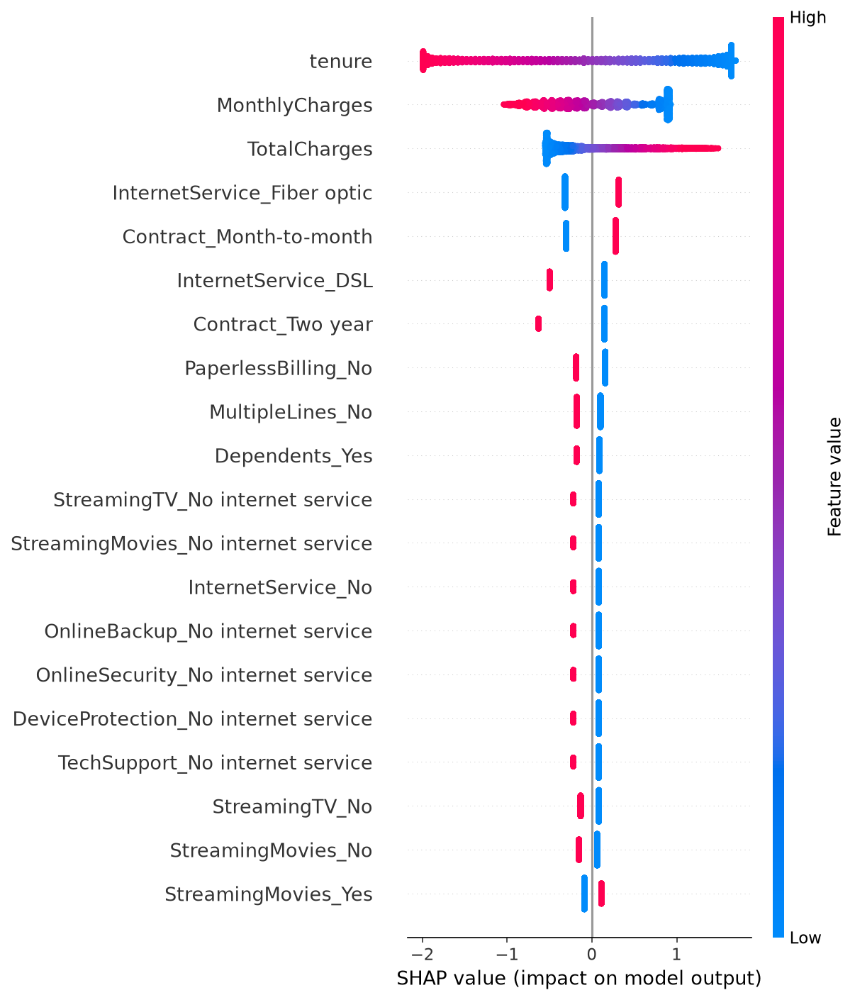

# Telco Customer Churn: Cost-Based Retention Decisions

A machine learning project that predicts which telecom customers are likely to leave **and decides whom to contact based on money, not accuracy**. The model's probability cut-off is chosen to maximise net savings from retention offers.



## The problem

A telecom company can send a retention offer to customers who might cancel. Offers cost money, and not every offer works. If the company contacts everyone, it wastes most of its budget. If it contacts no one, it loses customers it could have kept.

**Question:** which customers should receive an offer so that total savings are as high as possible?

## Headline results

Evaluated once on 1,409 customers the model never saw during training (374 of them churned):

| Strategy | Customers contacted | Churners reached | Wasted offers | Net savings |
|---|---|---|---|---|
| Contact nobody | 0 | 0 | 0 | $0 |
| Contact everybody | 1,409 | 374 | 1,035 | $17,066 |
| Model, default 0.50 cut-off | 318 | 209 | 109 | $33,006 |
| **Model, cost-based 0.25 cut-off** | 609 | 303 | 306 | **$40,452** |

- Choosing the cut-off by business cost saved about **23% more** than the default 0.50 cut-off, with the same model.
- It saved about **2.4 times** as much as contacting everyone.
- A perfect crystal ball would save $68,816, so the model captures about **59%** of the possible savings.

> These dollar figures depend on **assumed** costs (see below). They show how the method works, not a guaranteed business outcome.

## Cost assumptions

The dataset has no cost information, so these values are assumptions and can be changed in `src/evaluation.py`:

| Assumption | Value | Reasoning |
|---|---|---|
| Retention offer cost | $50 | A discount or a call |
| Value of a saved customer | $780 | About $65 average monthly bill x 12 months |
| Offer success rate | 30% | Not every contacted churner is saved |

From these: contacting a customer who would really churn gains **$184 on average** (0.30 x $780 - $50), and contacting one who would have stayed loses **$50**. The break-even churn probability is therefore about 21%. The data-driven cut-off (25%) lands close to that.

## Approach (CRISP-DM)

1. **Business understanding:** define success in money, state the cost assumptions (`docs/problem_statement.md`).
2. **Data understanding:** 7,043 customers, 21 columns, 26.5% churn. Found that `TotalCharges` is stored as text with 11 blanks, all belonging to brand-new customers (tenure 0). See `notebooks/01_eda.ipynb`.
3. **Data preparation:** cleaning, a stratified 80/20 split, scaling numeric columns and one-hot encoding categories inside a scikit-learn `Pipeline` so nothing leaks from the test set. See `notebooks/02_preprocessing.ipynb`.
4. **Modeling:** compared five approaches with 5-fold cross-validation on the training data only.
5. **Evaluation:** chose the probability cut-off from out-of-fold training predictions, then tested once on the held-out set. See `notebooks/04_evaluation.ipynb`.
6. **Deployment:** a FastAPI service and a Streamlit app that share the same prediction code.

### Model comparison (5-fold cross-validation, training data)

| Model | Accuracy | Precision | Recall | F1 | ROC-AUC |
|---|---|---|---|---|---|
| Baseline (always "stay") | 0.735 | 0.000 | 0.000 | 0.000 | 0.500 |
| Logistic Regression | 0.802 | 0.653 | 0.543 | 0.592 | 0.846 |
| Logistic Regression (balanced) | 0.748 | 0.517 | 0.801 | 0.628 | 0.846 |
| Random Forest | 0.802 | 0.672 | 0.496 | 0.570 | 0.845 |
| XGBoost | 0.803 | 0.662 | 0.529 | 0.588 | 0.847 |

**Finding:** the more complex models did not beat logistic regression (ROC-AUC 0.845 to 0.847 for all four). On this small, tidy table the information in the data is the limit, so I chose the simplest, most explainable model. The "balanced" variant ranks customers equally well but moves along the precision/recall trade-off, which is why the *cut-off*, not the model, was the lever that mattered.

## What drives churn



The model's strongest signals are short **tenure**, **month-to-month contracts** and **fiber optic internet** (higher risk), and **two-year contracts** (much lower risk). This matches the exploratory analysis: month-to-month customers churned about 43% of the time versus about 3% on two-year contracts.

SHAP explains what the *model* does, not what *causes* churn. `MonthlyCharges` and `TotalCharges` overlap heavily with tenure and service type, so they share credit in the explanation and should not be read as standalone causes.

## Limitations

- **Costs are assumptions.** The real offer success rate would need an A/B test.
- **One public sample dataset, one random split.** No confidence intervals, no time dimension, and no way to check drift.
- **Sensitive inputs.** `gender` and `SeniorCitizen` are model inputs. Fairness across groups has not been audited (see `docs/model_card.md`).
- **The app estimates `TotalCharges`** as months x monthly charges and does not check that charges are realistic for the chosen services.

## Project structure

```
telco-churn-cost-based/
  app/
    api.py                FastAPI service (POST /predict, GET /health)
    streamlit_app.py      Web app for non-technical users
  data/raw/               Put telco_churn.csv here (not stored in Git)
  docs/                   Problem statement, model card, figures
  models/                 Saved model and cut-off (model file is rebuilt by src.train)
  notebooks/              01 EDA, 02 preprocessing, 03 modeling, 04 evaluation
  src/
    data.py               Load, clean, split
    features.py           Preprocessing recipe
    evaluation.py         Cost assumptions and net-savings maths
    train.py              Train, choose cut-off, save
    predict.py            Score one customer
  tests/                  15 automated tests
  requirements.txt
```

## How to run it

```bash
# 1. Get the code and create an environment
git clone https://github.com/joenzau41-png/telco-churn-cost-based.git
cd telco-churn-cost-based
python -m venv .venv
source .venv/Scripts/activate        # Windows Git Bash. On macOS/Linux: source .venv/bin/activate
pip install -r requirements.txt

# 2. Download the data
curl -L -o data/raw/telco_churn.csv "https://raw.githubusercontent.com/IBM/telco-customer-churn-on-icp4d/master/data/Telco-Customer-Churn.csv"

# 3. Train the model and save it
python -m src.train

# 4. Run the tests
pytest -q

# 5a. Start the API, then open http://127.0.0.1:8000/docs
uvicorn app.api:app --reload

# 5b. Or start the web app
streamlit run app/streamlit_app.py
```

### Example API call

```bash
curl -X POST http://127.0.0.1:8000/predict -H "Content-Type: application/json" -d '{
  "gender": "Female", "SeniorCitizen": 0, "Partner": "No", "Dependents": "No",
  "tenure": 2, "PhoneService": "Yes", "MultipleLines": "No",
  "InternetService": "Fiber optic", "OnlineSecurity": "No", "OnlineBackup": "No",
  "DeviceProtection": "No", "TechSupport": "No", "StreamingTV": "No",
  "StreamingMovies": "No", "Contract": "Month-to-month", "PaperlessBilling": "Yes",
  "PaymentMethod": "Electronic check", "MonthlyCharges": 70.7, "TotalCharges": 151.65
}'
```

Response:

```json
{
  "churn_probability": 0.692,
  "contact_customer": true,
  "cutoff_used": 0.25,
  "expected_net_gain_if_contacted": 111.83
}
```

## Possible next steps

- Sensitivity analysis: how do the savings change if the offer success rate is 10% or 50%?
- Bootstrap confidence intervals around the savings figures.
- Audit performance across gender and senior-citizen groups, and test removing those inputs.
- Check probability calibration, since the cost maths relies on trustworthy probabilities.
- Deploy the app to a hosting service and add monitoring for data drift.

## Data source

[IBM Telco Customer Churn sample dataset](https://github.com/IBM/telco-customer-churn-on-icp4d) (7,043 customers). Please check the source for its terms of use.